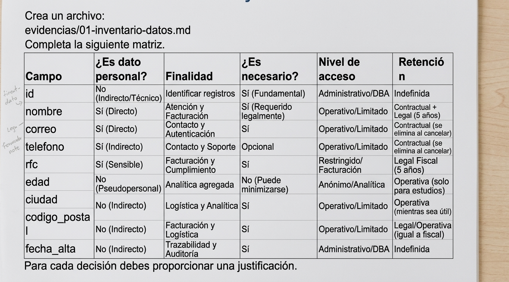
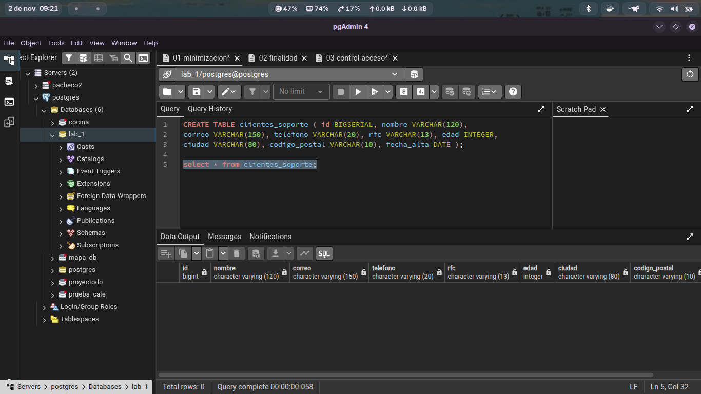
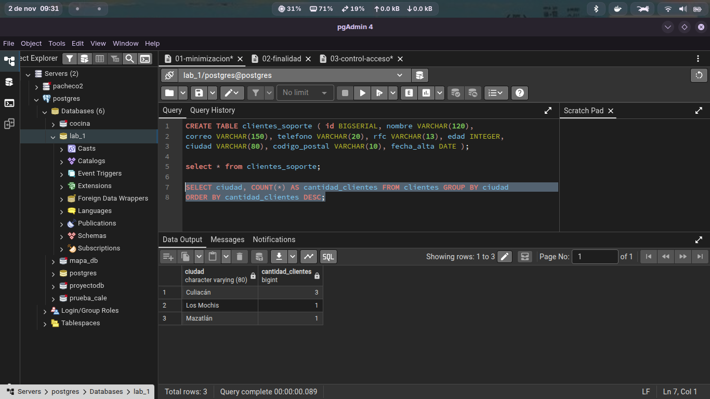
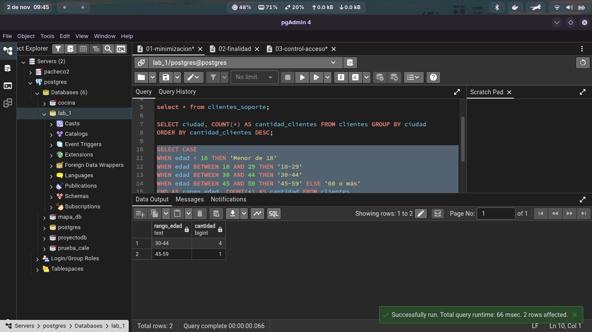

### Actividad 2 — Análisis del Principio de Minimización de Datos

#### 1. ¿Todos los campos son necesarios para atención al cliente?
**No**[cite: 1]. El área de atención al cliente únicamente requiere `nombre`, `correo` y `telefono` para identificar al usuario y ponerse en contacto con él[cite: 1]. Los demás campos (`rfc`, `edad`, `ciudad`, `codigo_postal`, `fecha_alta`) resultan irrelevantes para resolver solicitudes de soporte operativo[cite: 1].

#### 2. ¿Por qué soporte necesitaría conocer el RFC?
**Soporte no necesita conocer el RFC**[cite: 1]. El RFC es una clave de identificación tributaria vinculada estrictamente al área de facturación y al cumplimiento fiscal, por lo que no aporta valor técnico ni funcional a la gestión de tickets o atención al usuario[cite: 1].

#### 3. ¿Necesita conocer la edad?
**No**[cite: 1]. La edad no es necesaria para brindar soporte técnico o solucionar problemas con el servicio[cite: 1]. Conforme al escenario organizacional, la edad corresponde al área de analítica para la generación de estadísticas agregadas, no a la atención individualizada de personas[cite: 1].

#### 4. ¿Necesita conocer el código postal?
**No para la atención al cliente estándar**[cite: 1]. El código postal se relaciona con aspectos fiscales o de logística y envíos, pero no forma parte de la información requerida para la atención y soporte básico[cite: 1].

#### 5. ¿Qué principio de privacidad está relacionado con esta decisión?
Está relacionado principalmente con el **Principio de Minimización de Datos**[cite: 1]. Este principio exige que los datos recopilados y tratados sean únicamente los adecuados, pertinentes y estrictamente necesarios en relación con la finalidad para la que son procesados[cite: 1]. También se relaciona de forma complementaria con el **Principio de Limitación de la Finalidad**[cite: 1].

### Diseñamos una consulta que proporcione informacion agregada
Minimización de Riesgos: El área de analítica obtiene la información estratégica que requiere para la toma de decisiones sin necesidad de acceder a la tabla completa de clientes en estado puro

### Diseño de consulta
La consulta seleccionada agrupa la edad exacta de los clientes en rangos de edad y calcula la cantidad de personas pertenecientes a cada intervalo mediante la función de agregación

El área de analítica requiere identificar patrones demográficos para tomar decisiones de negocio (por ejemplo, saber qué grupo de edad predomina en la plataforma), pero no necesita identificar de forma individual a cada cliente. Al transformar la edad puntual en un rango (30-44, 45-59) y contar registros, la consulta disocia la métrica de la identidad de la persona.

Finalidad Operativa: El área de atención o facturación consulta registros individuales (nombre, correo, rfc) para resolver peticiones específicas.   Finalidad Analítica: Consulta datos acumulados o tendencias globales.   Esta consulta separa ambos entornos para garantizar que el análisis de datos no vulnere la privacidad de las operaciones del cliente.

Reducción del Riesgo de Filtración o Exposición
Si el resultado de esta consulta o el informe derivado de ella se exporta, comparte o compromete en un incidente de seguridad, no expone información sensible ni identificable de ningún titular.

