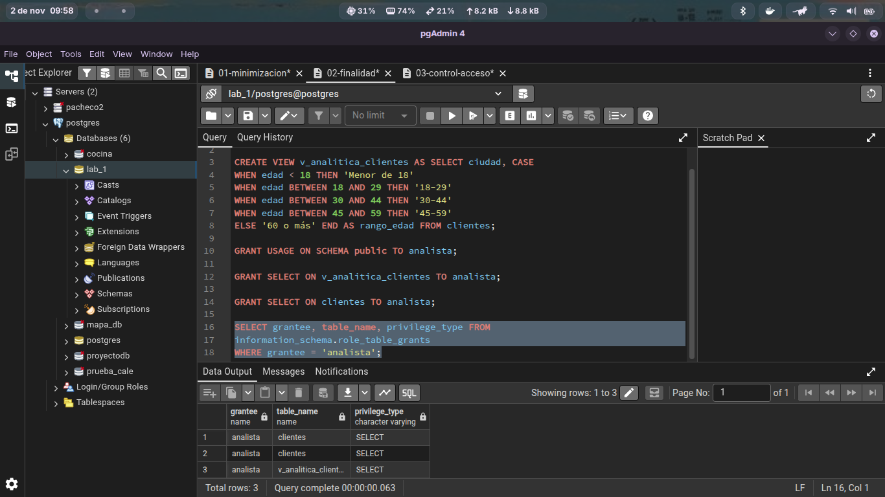
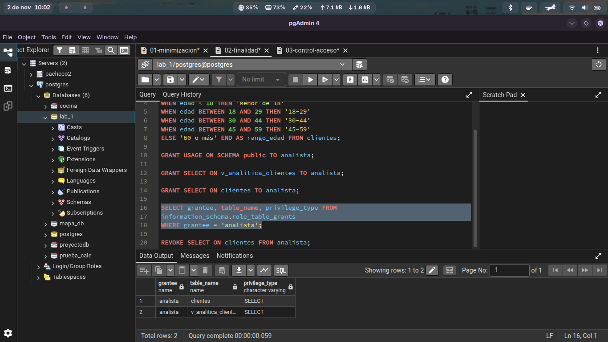

# Actividad 4 — Control de Acceso Relacionado con la Finalidad

## 1. Resumen de la Actividad
En esta actividad se implementaron controles de acceso a nivel de base de datos en PostgreSQL 16 para restringir los privilegios del rol `analista`. El objetivo principal fue garantizar que el área de analítica trabaje únicamente con datos anonimizados/agregados, previniendo el acceso no autorizado a Información de Identificación Personal (PII) como `nombre`, `correo`, `telefono` o `rfc`.

---

## 2. Procedimiento Técnico

### Paso 1: Creación de la Vista Anonimizada
Se creó la vista `v_analitica_clientes` para extraer únicamente la ubicación (`ciudad`) y agrupar las edades en rangos cualitativos (`rango_edad`), aislando la tabla base de `clientes`.

### Paso 2: Asignación de Permisos Restringidos
Se otorgó acceso de lectura (SELECT) exclusivamente sobre la vista recién creada:

### Paso 3: Identificación y Corrección del Hallazgo (Revocación)
Durante la verificación inicial se detectó la presencia de un privilegio excesivo otorgado por error sobre la tabla productiva (GRANT SELECT ON clientes TO analista;).

Para alinearse con las especificaciones del laboratorio y los principios de seguridad, se procedió a revocar dicho permiso: 
REVOKE SELECT ON clientes FROM analista;

### Análisis y Respuestas
¿Qué información puede consultar el rol?

Únicamente los datos geográficos (ciudad) y los rangos de edad procesados por la vista v_analitica_clientes.

¿Puede consultar directamente la tabla clientes?

No. Al intentar ejecutar SELECT * FROM clientes;, PostgreSQL devolverá un error de denegación de permisos (permission denied for table clientes).

¿Puede obtener nombre, correo y RFC?

No. Dichos campos fueron excluidos del diseño de la vista y no se tiene permiso de acceso a la tabla origen

¿Qué principio de privacidad se está aplicando?

El Principio de Limitación de la Finalidad y el Principio de Minimización de Datos, limitando el procesamiento a los datos necesarios para la finalidad analítica sin exponer identidade

# Actividad 5 — Análisis de Finalidad Secundaria

## 1. Análisis del Escenario
La empresa propone utilizar los datos recopilados originalmente para la gestión operativa y de ventas con el fin de **"Enviar promociones personalizadas basadas en la edad, ciudad y comportamiento de compra"**[cite: 1]. A continuación se presenta el análisis de privacidad y gobierno de datos[cite: 1].

---

## 2. Respuestas al Cuestionario

### 1. ¿El hecho de que la organización ya tenga los datos significa automáticamente que puede utilizarlos para cualquier finalidad?
**No**[cite: 1]. Que una organización posea legítimamente datos personales para una finalidad primaria (ej. gestión contractual o facturación) no la faculta para utilizarlos de manera arbitraria en finalidades distintas[cite: 1]. 

De acuerdo con el **Principio de Limitación de la Finalidad** y marcos como la LFPDPPP, los datos deben ser tratados exclusivamente para los fines informados en el Aviso de Privacidad y consentidos por el titular[cite: 1]. El envío de promociones constituye una **finalidad secundaria** que requiere una base jurídica adecuada o el consentimiento expreso de la persona[cite: 1].

---

### 2. ¿Qué preguntas debería realizar la organización antes de implementar este tratamiento?
Antes de iniciar la campaña o construir los scripts de procesamiento, la organización (involucrando al DBA, privacidad y legal) debe resolver[cite: 1]:
* **¿El Aviso de Privacidad contempla el uso publicitario/mercadotécnico?** Si no está especificado, se incurre en una infracción legal[cite: 1].
* **¿Se requiere consentimiento previo (opt-in) o se ofrece un mecanismo visible de oposición (opt-out)?**
* **¿Qué canal se utilizará para el envío y qué datos de contacto requiere?**
* **¿Existe un mecanismo técnico en la base de datos para registrar y respetar las solicitudes de oposición (derecho O)?**
* **¿El tratamiento es proporcional al beneficio esperado sin vulnerar las expectativas razonables de privacidad del usuario?**[cite: 1]

---

### 3. ¿Qué datos serían realmente necesarios?
Aplicando el **Principio de Minimización**, únicamente se requieren[cite: 1]:
* **Datos de Contacto:** `correo` (o `telefono` según el canal de envío)[cite: 1].
* **Datos de Segmentación:** `ciudad` y `rango_edad` (transformado desde `edad`)[cite: 1].
* **Datos de Preferencia/Comportamiento:** Categoría de producto o historial agregado de compras.

**Datos innecesarios que deben excluirse:** `rfc`, `nombre` completo (o utilizar solo un identificador/alias), `codigo_postal` detallado, `fecha_alta` y contraseña/credenciales[cite: 1].

---

### 4. ¿Necesitaría el área de marketing acceso directo a la tabla `clientes`?
**No**[cite: 1]. Otorgar acceso directo a la tabla productiva `clientes` violaría el principio de mínimo privilegio y expondría información confidencial (como el RFC o datos fiscales)[cite: 1]. Marketing debe recibir únicamente el conjunto de datos resultante procesado y filtrado para la campaña específica[cite: 1].

---

### 5. ¿Qué controles técnicos podrían limitar la información entregada?
Para limitar la exposición de datos se pueden implementar[cite: 1]:
1. **Vistas Filtradas y Anonimizadas:** Creación de vistas específicas (`CREATE VIEW v_campana_promocional`) que solo muestren el correo y la categoría asignada, excluyendo PII innecesaria[cite: 1].
2. **Columnas de Control de Consentimiento (`opt_out`):** Agregar un campo booleano en la base de datos (ej. `recibe_promociones BOOLEAN DEFAULT TRUE`) para que las consultas excluyan automáticamente a los clientes que se opusieron[cite: 1].
3. **Control de Acceso Basado en Roles (RBAC):** Asignar un rol de lectura restringido a marketing con permisos exclusivamente sobre las vistas de campaña, nunca sobre la tabla `clientes`[cite: 1].
4. **Seudonimización de Exportaciones:** Reemplazar el `id` o `nombre` real por un token o identificador temporal si se integran herramientas de e-mail marketing externas[cite: 1].

# Análisis e Implicaciones Técnicas

**Pregunta: ¿Qué información adicional debería proporcionar la organización además del resultado de esta consulta?**

Consultar únicamente la tabla productiva `clientes` devuelve el registro activo, pero técnicamente no abarca la totalidad del tratamiento de datos personales de la persona[cite: 1]. Desde la perspectiva de administración de bases de datos (DBA) y gobierno de datos, la organización debe identificar y proporcionar información técnica complementaria[cite: 1]:

#### 1. Registros en Tablas Relacionadas e Histórico Transaccional
* **Tablas derivadas y de soporte:** Datos almacenados en tablas secundarias como `clientes_soporte`, facturas, tickets de atención, pedidos o historial de transacciones[cite: 1].
* **Implicación técnica:** El DBA debe construir consultas con uniones (`JOIN`) o buscar el identificador (`id` o `correo`) en todas las tablas operativas relacionadas para consolidar el expediente completo del titular[cite: 1].

#### 2. Bitácoras de Auditoría y Trazabilidad (Audit Logs)
* **Historial de accesos y modificaciones:** Registros de quién ha consultado, actualizado o modificado la información del cliente, cuándo lo hizo y desde qué aplicación/IP[cite: 1].
* **Implicación técnica:** Inspección de las tablas o archivos de auditoría (ej. `pg_audit` o bitácoras de la base de datos) para demostrar la trazabilidad del uso de su información[cite: 1].

#### 3. Metadatos del Tratamiento
* **Origen y conservación:** Cuándo y a través de qué canal se recopiló el dato (`fecha_alta`), cuál es la finalidad para la que se conserva y durante cuánto tiempo más permanecerá guardado (periodo de retención)[cite: 1].
* **Implicación técnica:** Consulta de metadatos del sistema y matrices del catálogo de datos[cite: 1].

#### 4. Copias, Vistas y Exportaciones a Otros Sistemas
* **Entornos de analítica y marketing:** Presencia de la información en vistas (`v_analitica_clientes`), almacenes de datos (Data Warehouse), herramientas externas de e-mail marketing o reportes generados[cite: 1].
* **Implicación técnica:** Identificación de procesos ETL (Extracción, Transformación y Carga), tareas programadas (`cron`/`pg_cron`) o integraciones API que hayan enviado datos del usuario a terceros o sistemas secundarios[cite: 1].

#### 5. Indicación sobre Respaldos y Réplicas
* **Copia de seguridad (Backups):** Existencia de copias de seguridad donde la información aún reside por razones de recuperación ante desastres[cite: 1].
* **Implicación técnica:** Documentar el periodo de rotación de respaldos para responder cómo y cuándo la información será purgada definitivamente de los medios pasivos[cite: 1].

# Actividad 7 — Derecho de Rectificación y Trazabilidad

## 1. Ejecución y Verificación de la Actualización

Cuando un titular ejerce su derecho de rectificación al notificar que su información es inexacta o desactualizada, se ejecuta la actualización únicamente sobre el dato específico:

-- Actualización del correo electrónico del titular
UPDATE clientes 
SET correo = 'nuevo-correo@example.com' 
WHERE id = 1;

-- Verificación del cambio realizado
SELECT id, nombre, correo 
FROM clientes 
WHERE id = 1;

## Análisis e Implicaciones Técnicas
1. ¿Cómo podría comprobarse que el cambio fue autorizado?
Ticket de Solicitud de Derecho ARCO: Existencia de un folio o ticket formal en el sistema de atención/cumplimiento que valide la identidad del titular antes de proceder con el cambio.   
LABORATORIO 03 Alumnos (Privacidad Cumplimiento y Gobierno de Datos).docx

Validación de Identidad / OTP: Verificación previa mediante token enviado al canal verificado o confirmación por firma digital/documento oficial de identificación.

Correlación de Registros: Vinculación directa entre el ID del ticket de rectificación autorizado por el área de privacidad y el ID de la transacción ejecutada en la base de datos.   
LABORATORIO 03 Alumnos (Privacidad Cumplimiento y Gobierno de Datos).docx

2. ¿Debería registrarse quién realizó el cambio?
Sí, de manera obligatoria. Todo cambio sobre datos personales debe quedar registrado en bitácoras de auditoría (audit logs), almacenando:   
LABORATORIO 03 Alumnos (Privacidad Cumplimiento y Gobierno de Datos).docx
+ 1

Identidad del usuario: Cuenta del DBA, servicio o usuario de la aplicación que ejecutó la instrucción UPDATE.   
LABORATORIO 03 Alumnos (Privacidad Cumplimiento y Gobierno de Datos).docx

Origen de la conexión: Dirección IP y nombre de la aplicación cliente desde la cual se realizó la modificación.

Marca de tiempo (Timestamp): Fecha y hora exacta de la transacción.

Histórico de valores (Delta): El valor anterior (correo_anterior) y el nuevo valor asignado (correo_nuevo).

Técnicamente, esto se implementa en PostgreSQL mediante Triggers de auditoría o extensiones especializadas como pg_audit.   
LABORATORIO 03 Alumnos (Privacidad Cumplimiento y Gobierno de Datos).docx

3. ¿Por qué la trazabilidad será importante?
La trazabilidad (capacidad de rastrear el origen, motivo y autoría de cualquier modificación sobre la información) es fundamental por los siguientes motivos:   
LABORATORIO 03 Alumnos (Privacidad Cumplimiento y Gobierno de Datos).docx

Deslinde de Responsabilidades: Permite identificar si la modificación fue producto de una solicitud legítima del titular, una equivocación operativa de un usuario o un acceso malicioso/no autorizado.   
LABORATORIO 03 Alumnos (Privacidad Cumplimiento y Gobierno de Datos).docx

Cumplimiento Normativo y Auditoría: Permite demostrar ante auditores externos o autoridades de protección de datos (como el INAI) que la rectificación respondió a una solicitud ARCO legítima y autorizada.   
LABORATORIO 03 Alumnos (Privacidad Cumplimiento y Gobierno de Datos).docx

Integridad y Reversión de Datos: En caso de error o fraude, contar con la bitácora histórica facilita la recuperación exacta del estado del dato anterior sin afectar otros registros.

Preparación para Controles de Auditoría Avanzados: La trazabilidad sienta las bases técnicas para los mecanismos de monitoreo, detección de anomalías y auditoría de bases de datos que se profundizarán en la Unidad III.   
LABORATORIO 03 Alumnos (Privacidad Cumplimiento y Gobierno de Datos).docx
