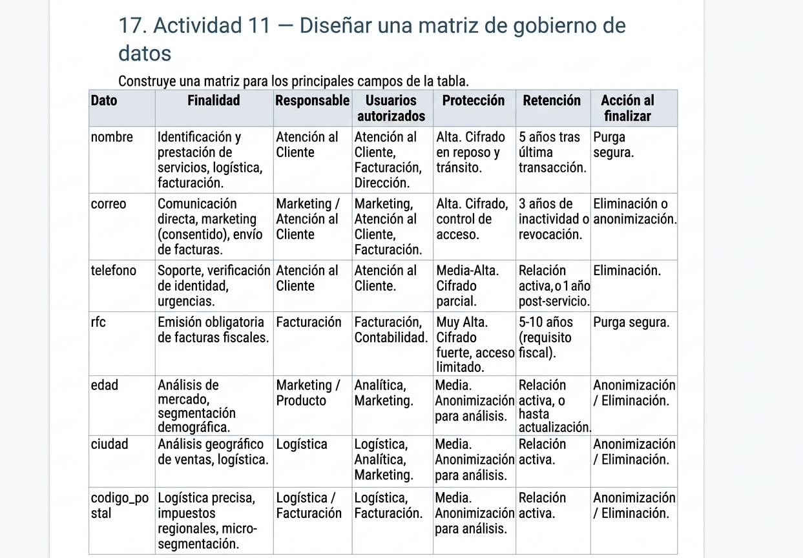

# La Matriz de Gobierno de Datos
La Matriz de Gobierno de Datos es una herramienta estratégica fundamental que define el "quién, qué, por qué, cuándo y cómo" de la gestión de la información en una organización. Esta matriz para la tabla de clientes tiene como objetivo central pasar de un modelo de acceso "todo o nada" a un modelo basado estrictamente en el principio de necesidad funcional y privilegio mínimo.

### 1. Identificación y Contacto (Datos PII Sensibles)
Campos: nombre, correo, telefono, rfc.

Análisis: Estos datos son PII (Información de Identificación Personal). Revelan la identidad directa del cliente y, en el caso del RFC, su estado fiscal. Su pérdida o mal uso conlleva altos riesgos legales, de reputación y privacidad (ej. robo de identidad).

Decisión: Por lo tanto, requieren la Protección más Alta (Muy Alta), como cifrado fuerte y control de acceso extremadamente limitado. Sus responsables son departamentos de contacto directo o cumplimiento (Atención al Cliente, Marketing, Facturación). Los usuarios autorizados deben ser solo aquellos que los necesitan para realizar su función: Atención para servir, Facturación para cumplir. Analítica rara vez necesita el RFC individual o el teléfono para informes generales; de ser necesario, deberían acceder a datos anonimizados.

Ciclo de Vida: La retención está fuertemente regulada (ej. fiscalmente para el RFC). La acción al finalizar debe ser la purga segura para eliminar cualquier rastro personal de la base operativa

### 2. Demográficos y Ubicación (PII Indirecto y Datos de Negocio)
Campos: edad, ciudad, codigo_postal.

Análisis: Aunque se consideran PII indirectos (especialmente el código postal), su función principal es proporcionar tendencias de mercado y operativas. Son menos críticos para la identidad directa, pero cruciales para la estrategia y logística.

Decisión: Requieren una Protección Media-Alta. Sus responsables son áreas estratégicas o de producto (Marketing, Producto, Logística). Los usuarios principales son Analítica y Marketing para segmentación, y Logística y Facturación para envíos y cumplimiento regional.

Ciclo de Vida: La retención dura mientras haya una relación de servicio activa. La acción al finalizar es la Anonimización (agrupar por rango de edad o geografía), lo que preserva el valor comercial del dato para análisis de tendencias históricas sin el riesgo de re-identificación de personas específicas.

### 3. El Principio de Necesidad Funcional
Esta matriz demuestra que el acceso no es un derecho por omisión. Como se puede observar:

El rol de Facturación no tiene acceso a la edad, porque no la necesita para emitir facturas.

El rol de Analítica no tiene acceso por defecto al rfc o telefono individuales, ya que su propósito es encontrar tendencias agregadas, no identificar a personas específicas.

El DBA es el guardián técnico de la infraestructura, no el dueño del dato de negocio. Implementa los controles definidos por los responsables del dato (ej. cifrado de RFC), pero no determina la política de acceso de negocio.

Limitar el acceso según la función reduce drásticamente la superficie de ataque en caso de una fuga de datos y asegura que los datos se utilicen solo para el propósito consentido y necesario, cumpliendo con leyes modernas de privacidad de datos como el GDPR o leyes locales.

