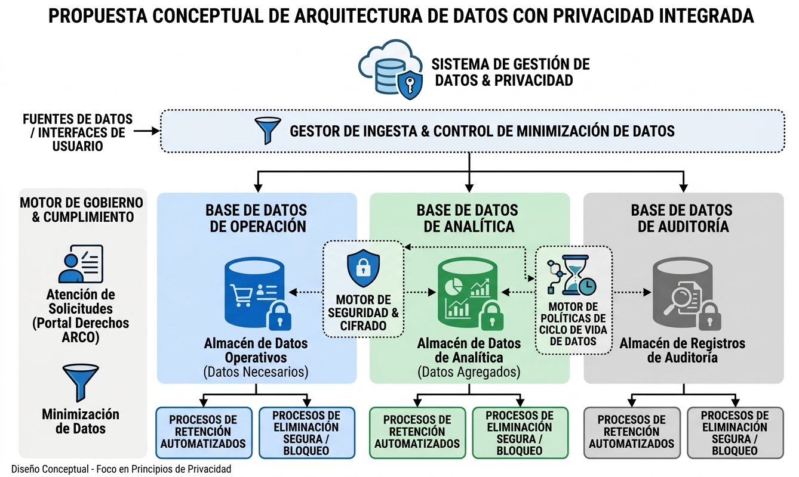

# Arquitectura
Esta arquitectura conceptual está diseñada para demostrar cómo los principios de privacidad se traducen en decisiones de diseño concretas dentro de un ecosistema de gestión de datos. El diseño mantiene la separación jerárquica principal solicitada (Operación, Analítica, Auditoría) y añade capas transversales de control.

### 1. Capa de Ingesta y Gobierno Transversal (Lado Izquierdo)
Portal de Atención de Solicitudes (Derechos ARCO/SAR): Este componente es el punto de entrada para que los usuarios finales ejerzan sus derechos de privacidad. Interactúa con un motor de cumplimiento para gestionar solicitudes de acceso, rectificación, cancelación y oposición de manera centralizada.

Gestor de Ingesta & Control de Minimización de Datos: Este es un punto de control crítico. Antes de que los datos se separen en las bases de datos por finalidad, pasan por un filtro que aplica el principio de minimización. Los datos innecesarios se descartan y los datos personales se enmascaran o anonimizan según las políticas establecidas antes del almacenamiento.
### 2. Capa de Almacenamiento Separado por Finalidad (Centro)
BASE DE DATOS DE OPERACIÓN: Almacena el "Almacén de Datos Operativos (Datos Necesarios)". Este repositorio es de lectura y escritura para procesos de tiempo real y contiene solo los datos mínimos indispensables para que la plataforma funcione (ej. un carrito de compras o la información de facturación). Mecanismo de protección: Cifrado en reposo.

BASE DE DATOS DE ANALÍTICA: Almacena el "Almacén de Datos de Analítica (Datos Agregados/Anonimizados)". Es un repositorio de solo lectura o carga por lotes. Antes de la carga, los datos operativos se agregan o anonimizan completamente para eliminar cualquier identificador personal, cumpliendo con la minimización secundaria.

BASE DE DATOS DE AUDITORÍA: Almacena el "Almacén de Registros de Auditoría & Linaje". Este repositorio es inmutable y solo de adición. Registra quién, qué, cuándo y dónde se accedió o modificó un dato, incorporando la Trazabilidad y el linaje de datos.
### . Capa de Ciclo de Vida y Seguridad Transversal
Motor de Trazabilidad & Linaje: Un componente de software que mapea el flujo de datos desde la ingesta hasta cada una de las bases de datos finales, asegurando que se sepa de dónde viene cada dato y a qué finalidad se ha destinado.

Motor de Seguridad & Cifrado: Un servicio transversal que gestiona las claves de cifrado y los algoritmos para proteger la información sensible en reposo (bases de datos) y en movimiento (flujos de datos).

Motor de Políticas de Ciclo de Vida: Centraliza las políticas de Retención (cuánto tiempo guardar) y Eliminación (cómo purgar). Interactúa directamente con las bases de datos para automatizar estos procesos.
### 4. Capa de Procesos de Ciclo de Vida (Fondo)
Procesos de Retención Automatizados / Eliminación Segura: Procesos de fondo que se ejecutan automáticamente basándose en las políticas del motor de ciclo de vida. Mueven datos operativos a archivos históricos, anonimizan datos agregados antiguos, o purgan datos completamente al finalizar su periodo de retención, implementando así el bloqueo y la destrucción segura.

